> [!IMPORTANT]
> **dough is SHADED inside Slimefun, not shipped as a standalone jar.** The source
> lives in the `dough-core` repo, but Slimefun consumes it as a Maven dependency
> (`com.github.drakescraft_labs:dough-core`) and relocates it when packaging to
> `com.github.drakescraft_labs.slimefun4.libraries.dough`. **There is no
> `dough.jar` in production.** Therefore, any change to `dough-core` requires:
> `mvn install` in dough-core -> **rebuild Slimefun** (and every plugin that
> shades it) -> upload those jars. Uploading dough on its own has no effect.

<div align="center">



# Slimefun 6 — DrakesCraft Core

**A maintained Slimefun core for Minecraft 1.21 → 26.2, built to run with the largest community addon collection we could load together.**

</div>

> ### 🏰 Play it live
>
> * 🎮 **Server IP**: `mc.drakescraft.cl` *(Java & Bedrock)*
> * 💬 **Discord**: [discord.gg/drakescraft](https://discord.gg/rv3vtXZTk7)
> * 🌐 **Web & Guide**: [web.drakescraft.cl](https://web.drakescraft.cl)
>
> *This core runs in production on DrakesCraft Season 2 together with the 110 Slimefun addons listed below.*

---

## What this is

This repository is the `Slimefun/Slimefun4` fork maintained by [SlimefunNewHorizons](https://github.com/SlimefunNewHorizons). It carries the core we run in production, ported from the original code base, plus the compatibility work needed so a very large number of community addons load together on current Minecraft. The original project is credited in [`docs/UPSTREAM_ATTRIBUTION.md`](docs/UPSTREAM_ATTRIBUTION.md) and the code stays under GPL-3.0.

The history of the previous standalone repository (`Slimefun4-Drake`) is kept on the branch `legacy/slimefun4-drake-1.21`. Our history is not a descendant of upstream's, so it cannot be merged into it; upstream is tracked on `experimental` for reference.

## Running in production (Season 2, measured 2026-11-20)

| Item | Value |
| :--- | :--- |
| Server | Purpur 26.2 build 141, Java 25 |
| Core | `Slimefun 11.0-Universal-26.x-SNAPSHOT` (this repo, branch `main`) |
| Addons reported by `/sf versions` | **110** |
| Consolidated suites | 9 suite jars, 8 of them register as addons ([Drakes-Suites](https://github.com/SlimefunNewHorizons/Drakes-Suites)) bundling ~90 more addon modules |

## Version support

The Universal 26.x line is one code base that is built and loaded from Minecraft **1.21** up to **26.2**. The jar is compiled against the Paper `1.21.11` API with Java 21 bytecode and runs on Java 21+ (production runs Java 25). Branch details: see "Universal 26.x line" below. Versions older than 1.21 are not supported.

## Addons loaded together in production

Names and versions are copied from the `Installed Addons` list printed by `/sf versions` on the production server, not from documentation. The nine consolidated suites come first; each bundles several addon modules (inventory per suite in [Drakes-Suites](https://github.com/SlimefunNewHorizons/Drakes-Suites#runtime-snapshot-season-2-2026-11-20)). The second table lists everything else the server reports, including plugins that register with Slimefun but are not strictly addons.

### Consolidated suites registered as addons (8)

| Addon | Version reported |
| :--- | :--- |
| DrakesBio | 2.0.0-26.X-SNAPSHOT |
| DrakesCombat | 2.0.0-26.X-SNAPSHOT |
| DrakesGenerators | 2.0.0-26.X-SNAPSHOT |
| DrakesMagic | 2.0.0-26.X-SNAPSHOT |
| DrakesMultiverse | 2.0.0-26.X-SNAPSHOT |
| DrakesServer | 2.0.0-26.X-SNAPSHOT |
| DrakesTech | 2.0.0-26.X-SNAPSHOT |
| DrakesUtility | 2.0.0-26.X-SNAPSHOT |

### Other addons and Slimefun-aware plugins (102)

| Addon | Version reported |
| :--- | :--- |
| AdvancedTech | 1.0.0 |
| AlchimiaVitae | 1.1.1 |
| AuraSkills | 2.4.0 |
| AxGraves | 1.32.1-Drake.1 |
| BetterChests | Dev - ? |
| BetterReactor | 1.3.0 |
| BreweryX | 3.7.0;port-26x |
| Bump | UNOFFICIAL |
| ChestTerminal | 1.21-Drake-SNAPSHOT |
| ColoredEnderChests | 1.20.6-Drake-SNAPSHOT |
| CompressionCraft | UNOFFICIAL |
| Coronalis | UNOFFICIAL |
| CringleBosses | 1.0.0 |
| CrystamaeHistoria | 1.0.1 |
| Cultivation | 3.3 |
| DankTech2 | MODIFIED |
| DemonicExpansion | 1.0.0 |
| DiosesDrakes | 0.6.0 |
| DrakesBosses | 1.0.0 |
| DrakesCrates | 2.0 |
| DrakesSlimeMarket | 1.2.0 |
| DrakesVotes | 1.0.0 |
| Drugfun | 1.0.0 |
| DyeBench | UNOFFICIAL |
| DyedBackpacks | 1.20.6-Drake-SNAPSHOT |
| DynaTech | 1.21-Drake-v7 |
| EcoPower | 1.20.6-Universal-26.x-SNAPSHOT |
| ElectricSpawners | 1.21.1-Drake |
| ElementManipulation | 1.1.1-UNIVERSAL-26x |
| EMCTech | MODIFIED |
| EquivalencyTech | modified |
| ExoticGarden | 1.3-UNIVERSAL-26x-SNAPSHOT |
| ExtraGear | 1.20.6-Drake-SNAPSHOT |
| ExtraHeads | 11.0-Drake-1.21.1-SNAPSHOT |
| ExtraTools | 1.2 |
| FastMachines | 11.0-Drake-1.21.1-SNAPSHOT |
| FlowerPower | 1.0.0 |
| FluffyMachines | 1.0.0 |
| FNAmplifications | Unoffical-4.2.4 |
| FoxyMachines | 1.21.11-Drake.1 |
| Galaxyfun | 11.0-Universal-26.x-Galaxyfun-SNAPSHOT |
| Gastronomicon | 1.21.11-Drake.1-UNIVERSAL-26x-SNAPSHOT |
| GeneticChickengineering | 1.1.DEV |
| GeyserHeads | 1.2 |
| GlobiaMachines | 1.0.0 |
| GuizhanLibPlugin | 2.5.0 |
| HeadLimiter | UNOFFICIAL |
| HotbarPets | 1.20.6-Drake-SNAPSHOT |
| IDreamOfEasy | DEV |
| InfernalExpansion | 1.0 |
| InfinityExpansion | 1.20.6-UNIVERSAL-26x-SNAPSHOT |
| Liquid | UNOFFICIAL |
| LiteXpansion | 1.21-Drake-v2 |
| Magic8Ball | UNOFFICIAL |
| MagicXpansion | 0.1.0-UNIVERSAL-26x-SNAPSHOT |
| MiniBlocks | UNOFFICIAL |
| MobCapturer | 11.0-Drake-1.21.1-SNAPSHOT |
| MultiverseCreatures | 5.1-RELEASE |
| MultiverseNets | 6.2 |
| Netheopoiesis | MODIFIED |
| NetworksV6-Drake | 11-SNAPSHOT |
| Nexcavate | 1.0-SNAPSHOT |
| NotEnoughAddons | UNOFFICIAL |
| Obsidian-Armor | 1.0.0 |
| ObsidianExpansion | PRIVATE |
| Odysseia | 1.1.3 |
| PotionExpansion | 1.0.0 |
| PrivateStorage | UNOFFICIAL |
| Quaptics | 0 |
| RandomExpansion | 1.0.0 |
| RelicsOfCthonia | 1.21.11-Drake.1 |
| RykenSlimeCustomizer | 20 |
| SaneCrafting | 0.1 |
| SensibleToolbox | 1.22-Drake-SNAPSHOT |
| SFCalc | 1.21-Drake-v1 |
| SfChunkInfo | Unoffical-1.11-SNAPSHOT.1 |
| SFMobDrops | 1.20.6-Drake-SNAPSHOT |
| SFPortalGunsExtension | 1.1.0 |
| SimpleMaterialGenerators | 1.0.0 |
| SimpleStorage | MODIFIED |
| SimpleUtils | MODIFIED |
| SlimeChem | 1.21-Drake-v7 |
| SlimeFrame | 1.7.0 |
| Slimefun-Disc | 1.5.DEV |
| SlimefunAdvancements | MODIFIED |
| SlimefunLuckyBlocks | 11.0-Drake-1.21.1-SNAPSHOT |
| SlimefunOreChunks | UNOFFICIAL |
| SlimefunTranslation | 11.0-Drake-1.21.1-SNAPSHOT |
| SlimefunWarfare | 1.0.0-drake |
| SlimeHUD | 1.3.1 |
| SlimeTinker | 1.2.1-Drake |
| SlimyBees | 1.0.0-UNOFFICIAL |
| SlimyRepair | 1.0.0 |
| SlimyTreeTaps | 11.0-Universal-26.x-SNAPSHOT |
| SmallSpace | MODED |
| SoulJars | 1.21-Drake-v1 |
| SpiritsUnchained | UNOFFICIAL |
| Supreme | 1.21.11-Drake.1 |
| TranscEndence | DevTest-33 |
| VillagerTrade | UNOFFICIAL |
| VillagerUtil | MODIFIED |
| WorldEditSlimefun | UNOFFICIAL |

---

## Runtime contract

- Target: **Java 21** and **Paper/Purpur 1.21.11**.
- Artifact: `Slimefun-1.2.DEV v11.0-Drake-1.21.11-SNAPSHOT.jar`.
- Storage: the normal Slimefun storage contract remains authoritative.
- Addons: addons load through the public Slimefun API; the core does not silently rewrite their data or recipes.
- Native acceleration: ABI 1 loads `native/libslimefun_ffi.so`, accelerates
  EnergyNet aggregation and exposes a Bukkit service for compatible plugins.
  `/sf native` reports calls, fallbacks and failures.

## Controlled SFMaster path

The guide delivery path has one authority: `CheatPolicy` in this Java core.
Category pages and search results both pass through the same checks.

- Staff with the bypass remains unrestricted.
- A player with `odysseia.sfmaster.active` receives one item per claim.
- The rolling quota is persisted in the player's PDC and survives restarts.
- Every delivered item is marked with its owner before inventory insertion.
- Addons are default-deny. Only configured addons or exact item IDs are eligible,
  and equipment/endgame blocklists still apply afterward.
- `/sf give` remains a staff operation. Odysseia blocks paid pass holders from
  using it and owns guide expiry, transfer prevention, and legacy audits.

## Universal 26.x line (branch `main`)

> `main` is the Universal line (1.21 → 26.2) and is what runs in production. The older Java-package line (`com.github.drakescraft_labs.slimefun4`, Paper 1.21.11 only) is preserved on `legacy/slimefun4-drake-1.21`.

- **Opt-in storage backends (`SfStore`)**: `storage.backend` = `file` (disk with fsync, default), `sqlite`, `mysql` or `postgres`. Keys: `sqlite-file`, `jdbc-url`, `jdbc-user`, `jdbc-password`. SQL backends are wrapped in `CachedSfStore`: writes are asynchronous and everything is flushed on shutdown. The first time SQL is used, data is imported from disk (the files are not touched); if SQL fails, it falls back to disk. Changing backend requires a restart.
- **New commands**: `/sf tick` (tick freeze), `/sf storage [status|export]`, `/sf balance [addon]`, `/sf itemid`, `/sf addons` (versions and item count per addon).
- **`core/balance`**: `BalanceService`, taken from Slimefun5.
- **Crafter Smart Port** (`CRAFTER_SMART_PORT`): interactor placed under an autocrafter; idea from SlimefunGuguProject/Slimefun4.
- **Cargo**: `ItemStackWrapper` with a single meta read (from Slimefun5).
- **Tests**: the test suite (1834 tests) is green.
- **dough-core** `1.3.1-Universal-26.x-SNAPSHOT` (namespace `io.github.bakedlibs`; fixes `CustomGameProfile` against the final Authlib), published at `maven.drakescraft.cl`.
- **Attribution (GPL-3.0)**: SlimefunGuguProject/Slimefun4, Slimefun5/Slimefun5 and Slimefun-United.

## Ported improvements

Fixes ported from other Slimefun forks and unmerged upstream PRs (all GPL-3, each covered by JUnit tests):

| Change | Origin | Commit |
| --- | --- | --- |
| Cargo frequency parsing without regex for single digits, overflow-safe, invalid nodes logged once | wickidcow/Slimefun-Legacy `f7c4ce9` | `fcef7af58` |
| Piglin bartering drops shuffled (no iteration-order bias) | Slimefun/Slimefun4 PR #4337 | `1ab50213c` |
| Swapping hands (F) blocked while a backpack is open | Slimefun/Slimefun4 PR #4275 | `0be7a9257` |
| Pickaxe of Vein Mining no longer breaks Slimefun blocks | Slimefun/Slimefun4 PR #4343 | `bc60de004` |
| Research placeholders/stats ignore researches without enabled items, no division by zero | Slimefun/Slimefun4 PR #4320 | `9ac85bf20` |
| Cargo Grid Monitor GUI on the Cargo Manager (plain click opens it; sneak+click keeps the visualizer toggle). Compiles and passes the suite; **not yet tried in-game** | SlimeCore-MC/Slimefun4Core (GPL-3, R2Ksanu / RuTwoK Labs) | this commit |

## Build and validation

Bulk asynchronous inventory saves capture at most 16 ordinary menus per
server-thread handoff. The controlled regression reduces 128 handoffs to eight;
this is not a production latency measurement. See the
[snapshot persistence fixture](docs/testing/snapshot-batch.md) for runtime and
restart checks with synthetic inventories.

Legacy machine recovery prepares reflective descriptors at item registration before addon JARs close. The closed-JAR and idempotence regressions run with `mvn test -Dtest=TestLegacyProcessingRecovery`; the disposable persistence fixture is documented in [docs/testing/legacy-recovery.md](docs/testing/legacy-recovery.md). A build alone does not establish runtime compatibility.


```bash
mvn package -DskipTests
mvn test -DlegacyMockBukkitTests \
  -Dtest=TestColorCodes,TestSlimefunSpelling,TestDoubleRangeSetting,TestEnumSetting,TestIntRangeSetting,TestItemSettings,TestMaterialTagSetting,TestNetworkManager,TestResearches,TestUpdaterService,TestRechargeableItems
```

GitHub Actions publishes the exact production JAR from a successful Java CI run and performs a Paper 1.21.11 end-to-end boot check for pull requests. Prefer that artifact to an unverified local build.

The isolated `ClaimWindowTest` does not require MockBukkit. The legacy MockBukkit
suite currently requires registry fixtures compatible with Paper 1.21.11; a
registry bootstrap failure is infrastructure debt, not a valid SFMaster result.

## Deployment discipline

1. Back up the active Slimefun JAR and storage before a core update.
2. Keep exactly one active Slimefun core JAR in `plugins/`.
3. Do not hot-reload Slimefun or replace its JAR while Paper is running.
4. Restart during a maintenance window and verify the startup log, addon load list, BlockStorage load and no duplicate-plugin warning.
5. Smoke-test the Slimefun Guide, a machine, a CargoNet operation and an EnergyNet operation before calling the update complete.

## DrakesCraft guides

- [Progression and automation](docs/GUIA_DE_PROGRESION_Y_AUTOMATIZACION.md)
- [Network integrity](https://github.com/SlimefunNewHorizons/NetworksV6-drake/blob/main/docs/INTEGRIDAD_DE_RED_DRAKESCRAFT.md)

## Using maven.drakescraft.cl

Release and snapshot builds of this project are published at **https://maven.drakescraft.cl** (a static Maven repository served from GitHub Pages; sources in [SlimefunNewHorizons/maven-repo](https://github.com/SlimefunNewHorizons/maven-repo)). The full matrix lives in [`docs/COMPATIBILITY.md`](https://github.com/SlimefunNewHorizons/maven-repo/blob/main/docs/COMPATIBILITY.md).

> **Warning:** the 1.21.11 and 26.x lines are **not binary-interchangeable** (different Java release, Paper API, and Java packages). Pick one line per server/addon and recompile your addon against the matching line.

| Artifact (`com.github.drakescraft_labs`) | Version | Minecraft | Java | Source branch |
|---|---|---|---|---|
| `slimefun-core` | `11.0-Drake-1.21.11-SNAPSHOT` | 1.21.11 | 21 | `legacy/slimefun4-drake-1.21` of this repo |
| `slimefun-core` | `11.0-Universal-26.x-SNAPSHOT` | 26.2 | 25 | `main` of this repo |
| `dough-core` | `1.3.1-DRAKE-v11-SNAPSHOT` | 1.21.11 | 21 | `main` of dough-core |
| `dough-core` | `1.3.1-Universal-26.x-SNAPSHOT` | 26.2 | 25 | `port-26x` of dough-core |
| `SefiLib` | `0.3.0-Drake-1.21.11` | 1.21.11 | 21 | `main` of SefiLib |
| `SefiLib` | `0.3.1-Universal-26.x-SNAPSHOT` | 26.2 | 25 | `port-26x` of SefiLib |

### Maven

```xml
<repositories>
  <repository>
    <id>drakescraft-labs</id>
    <url>https://maven.drakescraft.cl/</url>
    <snapshots><enabled>true</enabled></snapshots>
  </repository>
</repositories>

<dependencies>
  <!-- 26.2 line (Java 25) -->
  <dependency>
    <groupId>com.github.drakescraft_labs</groupId>
    <artifactId>slimefun-core</artifactId>
    <version>11.0-Universal-26.x-SNAPSHOT</version>
    <scope>provided</scope>
  </dependency>
  <dependency>
    <groupId>com.github.drakescraft_labs</groupId>
    <artifactId>dough-core</artifactId>
    <version>1.3.1-Universal-26.x-SNAPSHOT</version>
  </dependency>
  <dependency>
    <groupId>com.github.drakescraft_labs</groupId>
    <artifactId>SefiLib</artifactId>
    <version>0.3.1-Universal-26.x-SNAPSHOT</version>
  </dependency>
</dependencies>
```

For the **1.21.11 line (Java 21)** use instead `slimefun-core:11.0-Drake-1.21.11-SNAPSHOT`, `dough-core:1.3.1-DRAKE-v11-SNAPSHOT` and `SefiLib:0.3.0-Drake-1.21.11`.

### Gradle (Kotlin DSL)

```kotlin
repositories {
    maven("https://maven.drakescraft.cl/")
}

dependencies {
    // 26.2 line (Java 25)
    compileOnly("com.github.drakescraft_labs:slimefun-core:11.0-Universal-26.x-SNAPSHOT")
    implementation("com.github.drakescraft_labs:dough-core:1.3.1-Universal-26.x-SNAPSHOT")
    implementation("com.github.drakescraft_labs:SefiLib:0.3.1-Universal-26.x-SNAPSHOT")

    // 1.21.11 line (Java 21) -- do not mix with the lines above
    // compileOnly("com.github.drakescraft_labs:slimefun-core:11.0-Drake-1.21.11-SNAPSHOT")
    // implementation("com.github.drakescraft_labs:dough-core:1.3.1-DRAKE-v11-SNAPSHOT")
    // implementation("com.github.drakescraft_labs:SefiLib:0.3.0-Drake-1.21.11")
}
```

### Fallback: GitHub Packages

If `maven.drakescraft.cl` is unreachable, the same builds are mirrored in GitHub Packages under `SlimefunNewHorizons` (repositories `Slimefun4-Drake`, `dough-core`, `SefiLib`). Differences from the main repository:

- GitHub Packages **requires authentication even for public packages**: use a personal access token (classic) with at least `read:packages`. Never commit it; read it from an environment variable.
- GitHub Packages rejects uppercase artifact ids, so `SefiLib` is published there as **`sefilib`** (same version strings).
- The mirror carries the jars only (generated minimal POMs for the 1.21.11 line); transitive dependencies still resolve from `https://maven.drakescraft.cl/`, so keep both repositories declared.

`~/.m2/settings.xml` (placeholders only):

```xml
<settings>
  <servers>
    <server>
      <id>github-slimefun</id>
      <username>YOUR_GITHUB_USERNAME</username>
      <password>${env.GITHUB_TOKEN}</password> <!-- token with read:packages -->
    </server>
  </servers>
</settings>
```

and in your `pom.xml` (one `<repository>` per mirrored repo you need; the `id` must match the `<server>` id):

```xml
<repository>
  <id>github-slimefun</id>
  <url>https://maven.pkg.github.com/SlimefunNewHorizons/Slimefun4-Drake</url>
  <snapshots><enabled>true</enabled></snapshots>
</repository>
```

Package pages: `slimefun-core` and `drakes-slimefun-labs` (parent POM) under [Slimefun4-Drake](https://github.com/SlimefunNewHorizons/Slimefun4-Drake/packages), `dough-core` under [dough-core](https://github.com/SlimefunNewHorizons/dough-core/packages), `sefilib` under [SefiLib](https://github.com/SlimefunNewHorizons/SefiLib/packages).

## Maintainers

DrakesCraft Labs / JackStar. Upstream Slimefun licensing remains GPL-3.0.

## Support

This repository is the operational reference for the DrakesCraft core. Attach
generated error reports to the relevant DrakesCraft repository issue tracker;
do not publish them to public paste services because they can contain server
paths, plugin inventories or other operational metadata.
